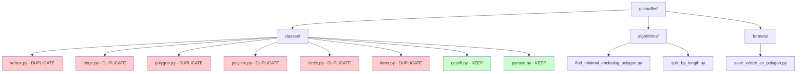
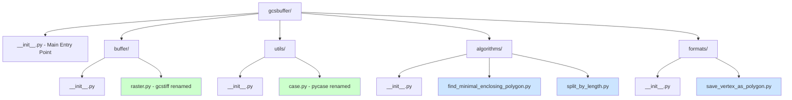
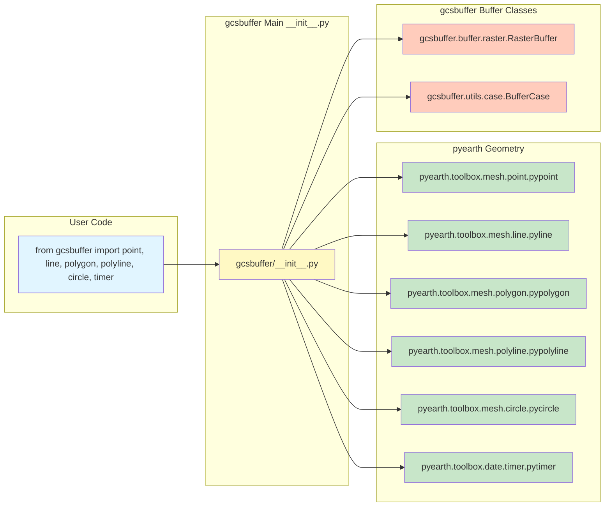
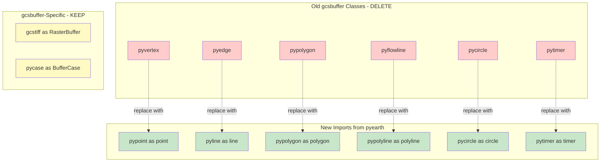
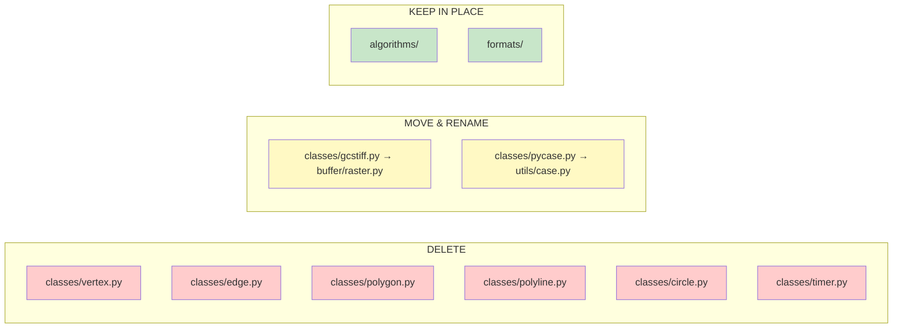

# gcsbuffer Package Structure Diagram

## Current Structure (Before Refactoring)

## Proposed Structure (After Refactoring)

## Import Flow Diagram

## Class Mapping Flow

## File Operations Summary

## Legend

- 🔴 Red: Files to DELETE (duplicates of pyearth)
- 🟢 Green: Files to KEEP (gcsbuffer-specific or from pyearth)
- 🟡 Yellow: Files to MOVE/RENAME
- 🔵 Blue: Supporting modules (algorithms, formats)
